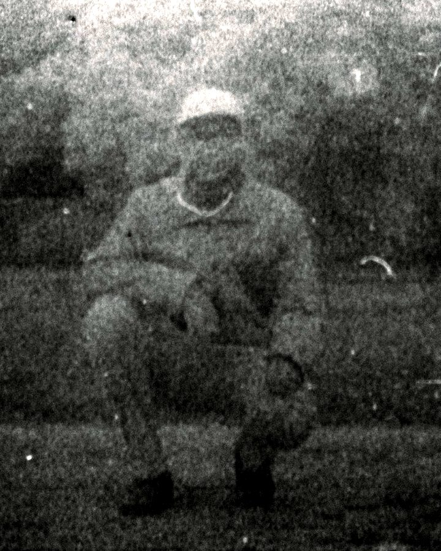

# Сайт службы медиации «НЛО»

Одностраничный статический сайт школьной службы медиации «НЛО» — «не ловите обид».
Главная, принципы, команда, достижения, галерея и подвал с городом и копирайтом.

## Как открыть

Просто откройте `index.html` в браузере — сайт не требует сборки и интернета.
Все шрифты лежат локально в `assets/fonts/`.

## Структура

```
index.html          — вся разметка и контент
assets/
  styles.css        — оформление, адаптивность, анимации
  script.js         — меню, прогресс скролла, появление блоков, параллакс, карусель
  favicon.svg       — иконка сайта
  fonts/            — локальные шрифты Manrope и Unbounded
```

## Цвет

Сайт окрашен в единую зелёную гамму (по образцу страницы Firefox VPN): одна
сквозная градиентная заливка на всю страницу, все секции прозрачные, карточки —
стеклянные тёмно-зелёные панели, акцент — лаймовый `#c7f46f`.

Палитра задана переменными в `:root` (`assets/styles.css`): `--forest`,
`--emerald`, `--lime`, `--mint`, `--paper`, `--line` и т.д. Переопределение темы
собрано в конце файла в блоке «ЕДИНЫЙ ЗЕЛЁНЫЙ ЦВЕТ» — правьте его, чтобы
поменять цвета всего сайта разом.

## Как заполнить пустые блоки

Фотографии кладутся в папку `assets/img/`. Имена файлов могут быть любыми.
Для портретов участников лучше подойдут вертикальные кадры (рекомендуем 4:5).

### Команда

В `index.html` найдите секцию `id="team"`. Куратор стоит в общей сетке,
первым в ряду с учениками, а не отдельной большой карточкой.

**Уже добавлено:** фотографии пяти участников (`assets/img/student-1.jpg` …
`student-5.jpg`) — все обрезаны в формат 4:5 и сжаты для веба. У куратора
(Полунина Ольга Викторовна) и двух последних участников пока заглушка.

Имена участников уже проставлены: Торцева София, Иванова Виктория,
Гегучадзе Дарина, Самойлич София, Ятагама Гамаге Владимир, Тохилл Харриет Анна,
Ремезов Кирилл.

**Как добавить фото оставшимся участникам.** В карточке найдите блок `photo-slot`
и замените его содержимое:

```html
<div class="photo-slot photo-slot--filled member-card__photo">
  
</div>
```

Класс `photo-slot--filled` убирает пунктирную рамку и иконку-заглушку.

**Имена.** Имена уже проставлены — при необходимости замените `Полунина Ольга
Викторовна`, `Торцева София`…`Ремезов Кирилл` на другие. У куратора оставьте
плашку `Куратор` — класс `10 «А»` в его карточке не выводится.

**Подписи.** Под именем уже стоит строка-подпись (`Наставник службы медиации`,
`Участник команды НЛО`) — её можно переписать; для участников без фото вместо
подписи стоит заглушка:

```html
<div class="placeholder-note placeholder-note--light">Описание</div>
```

Замените её на текст о человеке:

```html
<p class="member-card__about">Пара предложений о человеке и его роли в команде.</p>
```

### Достижения

Секция `id="achievements"`. Когда появятся дипломы, замените блок `.empty-case`
на сетку с наградами:

```html
<div class="diplomas reveal">
  <figure class="diploma">
    
    <figcaption>Название конкурса, 2026</figcaption>
  </figure>
  <figure class="diploma">
    
    <figcaption>Название конкурса, 2026</figcaption>
  </figure>
</div>
```

Стили `.diplomas` и `.diploma` уже добавлены в `assets/styles.css`.

### Галерея

Секция `id="gallery"` — горизонтальная лента публикаций. У поста есть фотография
и дата, а подпись-тег (`gallery-post__tag`) необязательна — её можно не ставить
или оставить только у отдельных публикаций. Стрелки влево-вправо появляются над
лентой и работают автоматически: когда постов много, лента листается, а на краях
кнопки блокируются.

Уже добавлены три поста: `assets/img/gallery-5nochev-shkole.jpg` (дата «14 октября»,
тег `#5ночейвшколе`), `assets/img/gallery-18oct.jpg` (дата «18 октября»,
тег `#ггрррвшколе`) и `assets/img/gallery-20oct.jpg` (дата «20 октября»,
тег `#полётнормальный`).

Замените фотографию-заглушку в посте:

```html
<article class="gallery-post">
  <div class="photo-slot photo-slot--filled gallery-post__media">
    
  </div>
  <div class="gallery-post__meta">
    <span class="gallery-post__date">14 марта</span>
    <span class="gallery-post__tag">выступление</span>
  </div>
</article>
```

Чтобы добавить ещё одну публикацию, скопируйте весь блок `<article class="gallery-post">`
и поменяйте фото, дату и хештег. Количество постов не ограничено — карусель
подстроится сама. Если публикаций станет меньше, чем помещается на экране,
стрелки автоматически станут неактивными.

## Полезно знать

- Все анимации отключаются автоматически, если в системе включено
  «Уменьшение движения» (`prefers-reduced-motion`).
- Мобильное меню открывается кнопкой в правом верхнем углу.
- Текст подвала (`Санкт-Петербург, Россия` и копирайт) находится в самом низу
  `index.html` в блоке `.footer__legal`.
