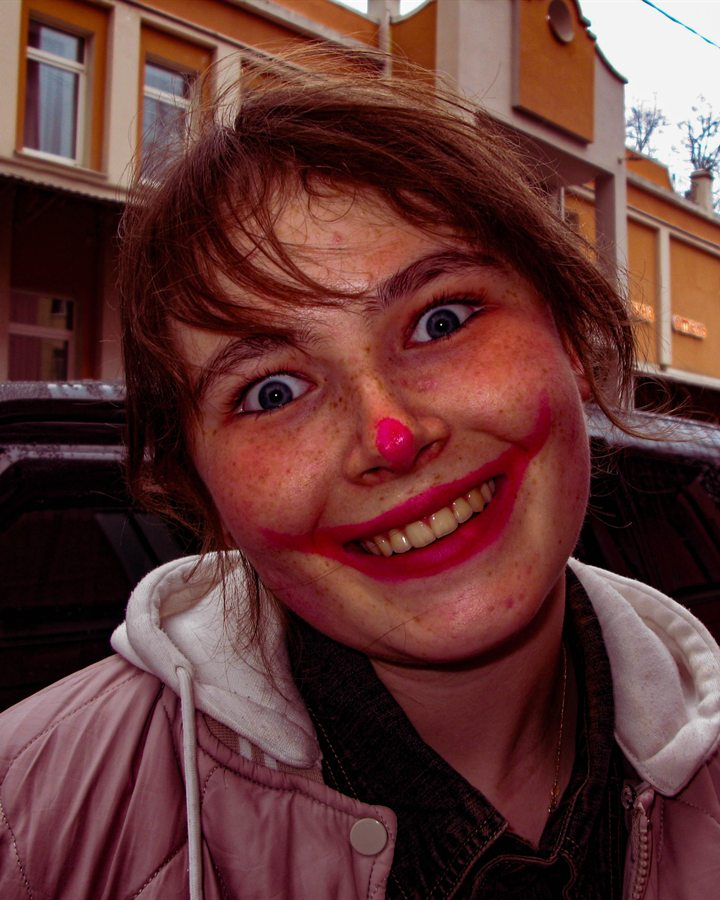

# Сайт службы медиации «НЛО»

Одностраничный статический сайт школьной службы медиации «НЛО» — «не ловите обид».
Главная, принципы, команда, достижения, галерея и подвал с городом и копирайтом.

## Как открыть

Просто откройте `index.html` в браузере — сайт не требует сборки и интернета.
Все шрифты лежат локально в `assets/fonts/`.

## Структура

```
index.html          — вся разметка и контент
assets/
  styles.css        — оформление, адаптивность, анимации
  script.js         — меню, прогресс скролла, появление блоков, параллакс, карусель
  favicon.svg       — иконка сайта
  fonts/            — локальные шрифты Manrope и Unbounded
```

## Как заполнить пустые блоки

Создайте папку `assets/img/` и положите туда фотографии. Имена файлов могут быть любыми.
Для портретов участников лучше подойдут вертикальные кадры.

### Команда

В `index.html` найдите секцию `id="team"`. Куратор теперь стоит в общей сетке,
первым в ряду с учениками, а не отдельной большой карточкой.

**Фотография.** В карточке найдите блок `photo-slot` и замените его содержимое:

```html
<div class="photo-slot photo-slot--filled member-card__photo">
  
</div>
```

Для ученика используйте тот же код, поменяв путь и `alt`:

```html
<div class="photo-slot photo-slot--filled member-card__photo">
  
</div>
```

Класс `photo-slot--filled` убирает пунктирную рамку и иконку-заглушку.

**Имена.** Замените `Куратор команды`, `Ученик 1`…`Ученик 7` на реальные имена.
У куратора оставьте плашку `Куратор` — класс `10 «А»` в его карточке не выводится.

**Описания.** Вместо `<div class="placeholder-note placeholder-note--light">Описание</div>`
напишите текст:

```html
<p class="member-card__about">Пара предложений о человеке и его роли в команде.</p>
```

### Достижения

Секция `id="achievements"`. Когда появятся дипломы, замените блок `.empty-case`
на сетку с наградами:

```html
<div class="diplomas reveal">
  <figure class="diploma">
    
    <figcaption>Название конкурса, 2026</figcaption>
  </figure>
  <figure class="diploma">
    
    <figcaption>Название конкурса, 2026</figcaption>
  </figure>
</div>
```

Стили `.diplomas` и `.diploma` уже добавлены в `assets/styles.css`.

### Галерея

Секция `id="gallery"` — горизонтальная лента публикаций. У каждого поста есть
фотография, дата и хештег. Стрелки влево-вправо появляются над лентой и работают
автоматически: когда постов много, лента листается, а на краях кнопки блокируются.

Замените фотографию-заглушку в посте:

```html
<article class="gallery-post">
  <div class="photo-slot photo-slot--filled gallery-post__media">
    
  </div>
  <div class="gallery-post__meta">
    <time class="gallery-post__date" datetime="2026-03-14">14 марта 2026</time>
    <span class="gallery-post__tag">#выступление</span>
  </div>
</article>
```

Чтобы добавить ещё одну публикацию, скопируйте весь блок `<article class="gallery-post">`
и поменяйте фото, дату и хештег. Количество постов не ограничено — карусель
подстроится сама. Если публикаций станет меньше, чем помещается на экране,
стрелки автоматически станут неактивными.

## Полезно знать

- Все анимации отключаются автоматически, если в системе включено
  «Уменьшение движения» (`prefers-reduced-motion`).
- Мобильное меню открывается кнопкой в правом верхнем углу.
- Текст подвала (`Санкт-Петербург, Россия` и копирайт) находится в самом низу
  `index.html` в блоке `.footer__legal`.
